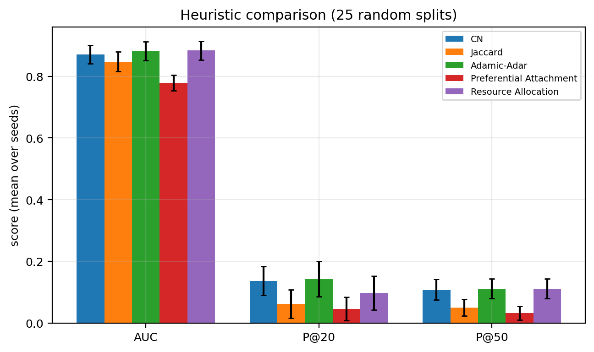
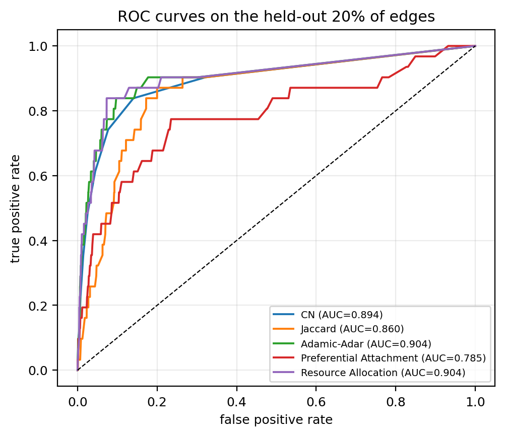
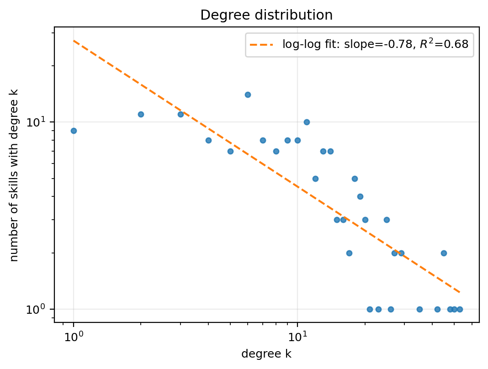
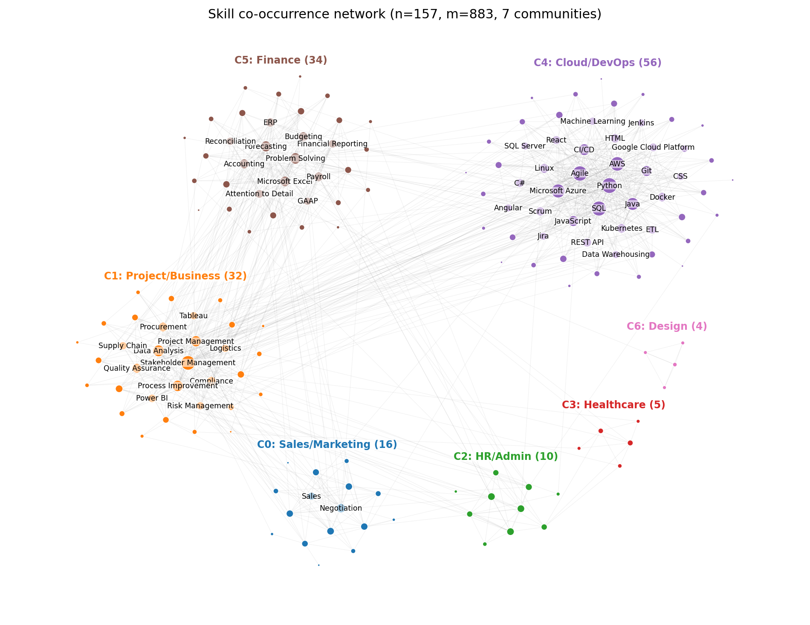
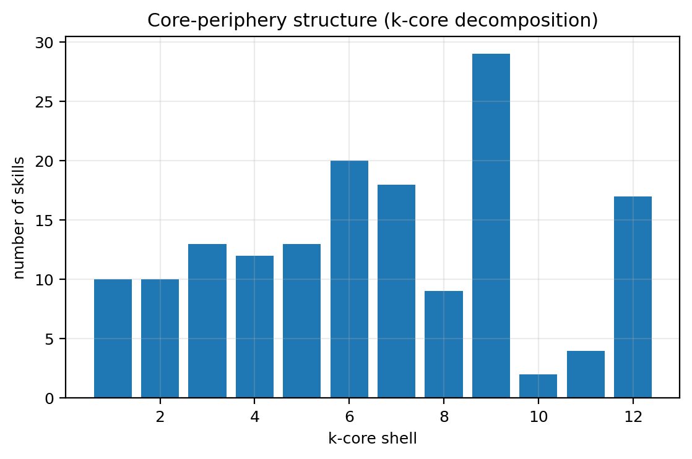
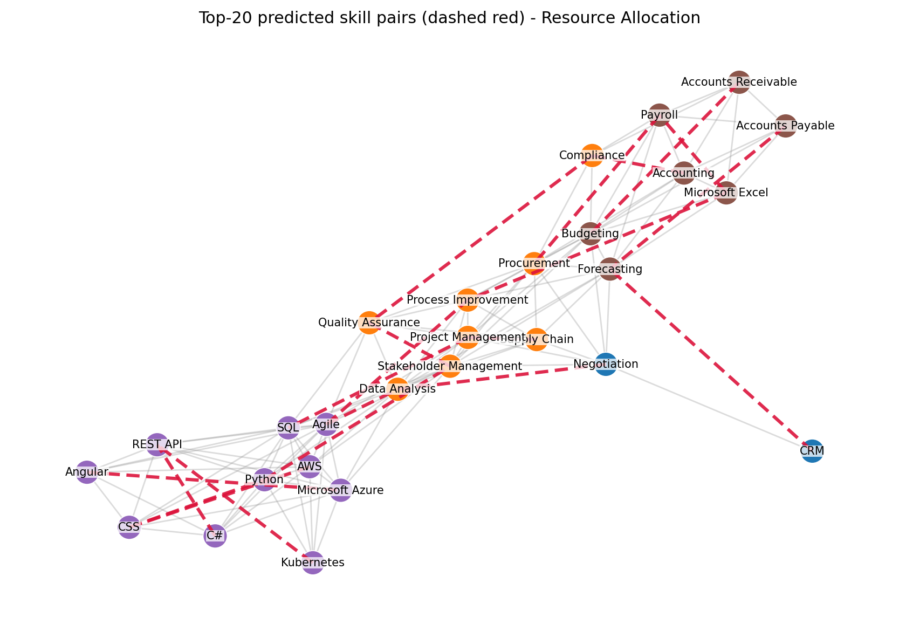

# Skill Recommendation via Link Prediction

## Predicting which skills the job market will demand together, from a skill co-occurrence network

**Course:** Social Network Analysis (AAT)
**Student:** ____________________  **Roll number:** ____________________
**Date:** November 2026

---

## Abstract

Choosing what to learn next is usually treated as a question about one skill. It is really a question about combinations: the value of a skill depends on what it is used with. This project turns 27,846 LinkedIn job postings (10 August to 4 November 2023) into a skill co-occurrence network with 165 skills and 883 edges, where an edge means two skills were demanded in the same posting often enough, and selectively enough, to be a real pairing rather than a coincidence. Twenty percent of the edges are hidden, every remaining skill pair is scored with Common Neighbours, Jaccard, Adamic-Adar, Preferential Attachment and Resource Allocation, and the scores are evaluated with Precision@K, Recall@K, F1@K and ROC-AUC over 25 random splits. Resource Allocation ranks best overall (AUC 0.8837) and Adamic-Adar has the best Precision@20 (0.142), roughly 9.5 times the 1.5 percent base rate; Preferential Attachment is the weakest (AUC 0.7787). A Random Forest using the five indices plus endpoint degrees reaches AUC 0.9189, and a temporal split, training on older postings and testing on later ones, confirms that neighbourhood-based indices still work forward in time (Common Neighbours Precision@20 0.45) while Jaccard collapses. The observed network is strongly small-world (sigma 6.06, clustering 0.5145 against 0.0726 for a random graph of the same size), has seven Louvain communities (modularity 0.528) that partly reproduce the curated skill domains (NMI 0.499), and is strongly homophilous: 75.2 percent of observed edges sit inside a community against a 19.1 percent baseline for random non-edges. The final output is a filtered Top-20 list of skill pairs that are not yet connected, led by Python and Stakeholder Management, Microsoft Excel and Payroll, C# and REST API, Kubernetes and REST API, plus a `recommend(skill, k)` function that answers what to learn next given a skill.

**Keywords:** link prediction, co-occurrence network, skill demand, Adamic-Adar, resource allocation, community structure, homophily, small-world.

---

## How this report maps to the rubric

| Rubric item | Where it is covered |
|---|---|
| 1. Problem definition and network modelling | Sections 1, 2 |
| 2. Data preparation and network construction | Sections 4, 5.1, 5.2 |
| 3. SNA analysis and link prediction | Sections 5.3, 7 |
| 4. Algorithm comparison and validation | Section 6 |
| 5. Recommendation and interpretation | Section 8 |
| 6. Presentation and visualisation | `docs/deck.pptx`, `docs/cytoscape_guide.md`, `figures/`, `viz/` |

---

## 1. Introduction

A job posting is a bundle. When a company asks for Python, SQL and AWS in one advert, it is not making three independent requests; it is describing one role. Those bundles are observable at scale, and they carry information that no single skill page can: which capabilities are actually used together in practice. Read as a network, skills are nodes and bundles are edges. The interesting structure is then not the popularity of a skill but its position: what it connects to, which communities it bridges, and which connections are missing.

This matters because the labour market is a network that learners navigate. A student who knows Python wants to know which adjacent skill makes Python more valuable in the roles they are aiming at. A curriculum designer wants to know which combinations employers already expect, and which ones are forming but not yet named. Both questions are link prediction questions: given the pairs we have observed, which pairs that we have not observed are likely to be real?

The project therefore does three things:

1. It builds a reproducible skill co-occurrence network from real postings, with a documented cleaning pipeline and an edge rule that has a defensible justification.
2. It runs a complete link-prediction benchmark on that network, with hand-implemented indices, repeated splits, two negative-sampling regimes and a temporal hold-out.
3. It converts the benchmark into a product: a ranked, filtered list of skill pairs and a per-skill recommendation function, interpreted against the syllabus concepts (triadic closure, homophily, weak ties, structural holes, core-periphery, small-world).

The headline finding is that the structure of the network does most of the work. Simple neighbourhood overlap predicts held-out skill pairs far better than chance, and it keeps doing so when the test edges come from later postings rather than from a random hide. The weakness is equally informative: Preferential Attachment, which only rewards degree, performs worst, which is what a selective, community-structured graph should do.

---

## 2. Problem definition and network modelling

### 2.1 Formal problem

Let *P* be a set of postings and *S* a set of skills. The data is a bipartite incidence relation *B* between postings and skills. The projection onto skills gives an undirected, weighted graph *G = (S, E, w)* where

*w(u, v) = |{p in P : (p, u) in B and (p, v) in B}|*

so the weight of an edge is the number of postings that mention both skills.

The observed graph is split into a training graph *G_T = (S, E_T)* and a held-out set *E_test = E \ E_T*. A link-prediction index is a function *s(u, v)* computed from *G_T* alone. The task is to rank all pairs *(u, v)* that are not edges of *G_T* so that pairs in *E_test* come first. Success is measured with Precision@K, Recall@K, F1@K and ROC-AUC over that ranking.

The product question is the same function applied to the full observed graph: rank all pairs that are not edges of *G* at all, filter them, and present the top ones as "skills the market is likely to demand together next". The recommendation function is the same ranking restricted to pairs that contain a given skill.

### 2.2 Domain selection

Three properties made this domain a good fit:

* **The data exists at scale and in the right shape.** Postings are naturally multi-skill documents, so co-occurrence is directly observable rather than inferred from behaviour.
* **The relationships are genuinely non-trivial.** Not every pair that appears together is a real pairing: some co-occur because both are common. That makes edge selection a modelling decision rather than a formatting step, which is exactly the kind of decision the rubric asks to justify.
* **The output is actionable.** "Learn Rust next" is advice; "learn Rust because it closes a structural hole between the systems and data communities in your skill set" is advice a student can defend in an interview.

### 2.3 Node and edge mapping

| Real-world entity | Network element | Attributes stored |
|---|---|---|
| Skill (canonical name, e.g. `python`, `sql`, `docker`) | Node | Domain, degree, weighted degree, community, betweenness, constraint, PageRank, HITS hub and authority, k-core, generic-skill flag |
| Two skills demanded in the same posting | Undirected edge | Weight (number of such postings), PMI, predicted flag, prediction score |
| A posting | Not a node in the final graph; it is the evidence that creates edges | Posting id, date, title, experience level, location |
| A curated domain (Programming, Cloud/DevOps, Finance, ...) | Node attribute, used to test whether communities recover domains | 19 domains over 245 vocabulary entries |
| A predicted pair | Edge with `predicted = 1` and `weight = 0`, so it can be styled separately | Score, shared-neighbour count |

### 2.4 Modelling choices and why

**Undirected.** Co-occurrence is symmetric by construction: a posting that mentions Python and SQL provides exactly the same evidence for SQL and Python. A directed graph would need an ordering or a dependency, and the data contains neither. Directionality is therefore not lost information here; it was never present.

**Weighted, then filtered to a simple graph for scoring.** The weight carries the strength of the evidence and is used to choose edges, to draw the network and to compute weighted PageRank. The link-prediction indices are defined on the unweighted neighbourhood, which is the standard formulation (Liben-Nowell and Kleinberg, 2007) and is what makes Common Neighbours and Adamic-Adar comparable to their textbook definitions.

**Giant component only.** After filtering, the graph has seven components. Link prediction on isolated nodes is not just hard, it is undefined, because a node with no neighbours has no neighbourhood overlap with anything. The eight isolated skills (Android, Communication, HVAC, PHP, Preventive Maintenance, VPN, Welding, iOS) are reported rather than silently dropped. This is a loss of coverage, and it is stated as one in Section 9.

**Unipartite projection of a bipartite structure.** Keeping postings as nodes would make the graph 27,846 + 165 nodes with 155,027 edges, and the prediction target would be a posting-skill link, which is a different question. The projection answers the question the project actually asks: which skills belong together. The cost is that posting-level information (seniority, salary, company) cannot be used as an edge feature, which is a legitimate direction for future work.

---

## 3. Related work

Link prediction was formalised as a benchmark problem by Liben-Nowell and Kleinberg (2007), who showed that simple neighbourhood indices are hard to beat on social networks and introduced the evaluation protocol (hide edges, rank non-edges) used here. The indices themselves come from different traditions: Common Neighbours is the triadic-closure intuition (Granovetter, 1973; Rapoport, 1953), Jaccard normalises overlap by neighbourhood size, Adamic and Adar (2003) weight shared neighbours by rarity, Preferential Attachment comes from the degree-driven growth model of Barabasi and Albert (1999), and Resource Allocation (Zhou, Lu and Zhang, 2009) sharpens Adamic-Adar.

The structural concepts used in Section 7 are equally standard: clustering and transitivity as the operational trace of triadic closure (Newman, 2001), communities and modularity (Newman and Girvan, 2004; Blondel et al., 2008), small-world structure and its coefficient (Watts and Strogatz, 1998), degree assortativity (Newman, 2002), structural holes and constraint (Burt, 1992), core-periphery structure through k-cores (Seidman, 1983), and the link-analysis centrality measures PageRank (Page et al., 1999) and HITS (Kleinberg, 1999).

The applied side is less settled. Skill and occupation adjacency is studied in labour economics as "skill relatedness", usually with co-occurrence or task similarity between occupations. What is less common is treating the skill graph itself as the prediction target and validating the prediction temporally, which is the gap this project occupies.
---

## 4. Dataset and network construction

### 4.1 Source and scope

The project uses the LinkedIn job postings dataset in the schema of the `arshkon/linkedin-job-postings` collection, downloaded as a single file `job_postings.csv` from the Hugging Face mirror `xanderios/linkedin-job-postings` and stored as `data/raw/job_postings_hf.csv`. It contains 33,246 postings with 28 columns, including `job_id`, `title`, `description`, `listed_time`, `formatted_experience_level` and `location`.

This is a deliberate deviation from the brief's primary dataset. The brief named the 1.3 million posting Kaggle dataset that ships a `job_skills` table, but that download requires Kaggle credentials, which were not available, and its `skills_desc` field is only populated for a small fraction of rows. The pipeline therefore supports both layouts: `skills_table` mode reads `job_skills.csv` directly, and `descriptions` mode extracts skills from free text with a curated vocabulary. The run reported here uses `descriptions` mode on the mirror. The code path for the Kaggle file is implemented and documented; swapping the input does not change any stage after loading.

Three consequences are worth stating up front. The corpus is a sample, not the full 1.3 million postings, and it spans 10 August to 4 November 2023, roughly three months. It is English-language and LinkedIn-centric. And because skills are extracted rather than supplied, recall is bounded by the vocabulary. None of these invalidate the method; all of them bound the claims.

### 4.2 Skill extraction and normalisation

Skills are extracted with the curated vocabulary in `src/skills_vocab.py`: 245 canonical skills across 19 domains, each with an alias list. Extraction is greedy longest-match over token n-grams, so `machine learning` is consumed as one skill before `learning` could match anything else, and `sql` can never be found inside `mysql`.

Normalisation is deliberately conservative. Case and punctuation are normalised, unicode dashes are unified, and a checked alias table maps obvious variants (`js` to `javascript`, `postgres` to `postgresql`, `k8s` to `kubernetes`). There is no fuzzy matching: fuzzy matching merges `java` with `javascript` and `c` with `c++`, which would corrupt the graph in a way that is invisible in the results. The same reasoning applies to `+`, `#`, `.` and `/`, which are preserved so that `c++`, `c#`, `.net`, `node.js` and `ci/cd` survive.

On the real data this produces 155,027 skill mentions across 27,846 postings that contain at least two recognised skills, a mean of 5.57 skills per posting.

### 4.3 Cleaning

Two cleaning steps do real work.

**Deduplication within a posting.** A posting that lists Python three times counts Python once. Without this, a verbose posting inflates every co-occurrence weight that involves its skills, and the weights stop being comparable across postings.

**Rarity filter.** A skill must appear in at least 100 postings (configured as `min_postings`). Below that threshold, an edge is supported by a handful of postings, and Jaccard and Adamic-Adar are unstable because they divide by small neighbourhoods. The filter keeps 165 of the 245 vocabulary skills while retaining 83.8 percent of postings, so the loss is in the tail of the vocabulary rather than in the corpus.

The resulting table is `data/processed/skills_long.csv.gz`, one row per (posting, skill), which is the only input every later stage reads.

| Quantity | Value |
|---|---|
| Postings in the source file | 33,246 |
| Postings with at least two recognised skills | 27,846 (83.8 percent) |
| Skills in the curated vocabulary | 245 |
| Skills above the rarity filter (100 postings) | 165 |
| Skill mentions | 155,027 |
| Mean skills per posting | 5.57 |
| Posting date range | 2023-08-10 to 2023-11-04 |
| Distinct co-occurring pairs | 10,764 |

*Table 1. The corpus after cleaning, as reported by the run.*

### 4.4 The edge rule: support and selectivity

Counting co-occurrences is not the same as finding relationships. Two skills can appear together thousands of times simply because both are popular: Microsoft Excel and Leadership meet in any count threshold and mean nothing by it. A raw count rule keeps those pairs and drops genuinely selective pairs between rarer skills.

The edge rule therefore has two conditions:

1. **Support:** the pair co-occurs in at least *t* postings.
2. **Selectivity:** the pair's pointwise mutual information is at least `pmi_min`, where

*PMI(u, v) = log( (w(u, v) * N) / (count(u) * count(v)) )*

with *N* the number of postings in the cleaned corpus. PMI compares how often the pair is observed with how often independence would predict. A positive value means the skills are found together more than their popularity explains; a value near zero means the pairing is what chance would produce.

To choose *t* from the data rather than by taste, the graph was rebuilt over a grid of *t* in {30, 50, 75, 100, 150} and `pmi_min` in {0.0, 0.5, 1.0}. The table reports the trade-off: sparser graphs have more components and a smaller giant component but higher transitivity, because the surviving edges are the strong, clustered ones.

| t | pmi_min | Edges | Components | Giant | Density | Transitivity | Diameter (giant) |
|---|---|---|---|---|---|---|---|
| 30 | 0.0 | 2285 | 1 | 165 | 0.1689 | 0.4474 | 4 |
| 30 | 0.5 | 1362 | 2 | 164 | 0.1007 | 0.4411 | 5 |
| 30 | 1.0 | 938 | 8 | 158 | 0.0693 | 0.5086 | 9 |
| 50 | 0.0 | 1582 | 5 | 160 | 0.1169 | 0.4108 | 4 |
| **50** | **0.5** | **885** | **7** | **157** | **0.0654** | **0.3874** | **6** |
| 50 | 1.0 | 592 | 17 | 143 | 0.0438 | 0.4464 | 10 |
| 75 | 0.0 | 1120 | 14 | 151 | 0.0828 | 0.3878 | 6 |
| 75 | 0.5 | 563 | 25 | 138 | 0.0416 | 0.3392 | 6 |
| 75 | 1.0 | 357 | 42 | 120 | 0.0264 | 0.3996 | 15 |
| 100 | 0.0 | 843 | 34 | 132 | 0.0623 | 0.3716 | 5 |
| 100 | 0.5 | 391 | 46 | 119 | 0.0289 | 0.3110 | 7 |
| 100 | 1.0 | 234 | 66 | 87 | 0.0173 | 0.3757 | 10 |
| 150 | 0.0 | 541 | 60 | 106 | 0.0400 | 0.3663 | 6 |
| 150 | 0.5 | 219 | 71 | 92 | 0.0162 | 0.2732 | 8 |
| 150 | 1.0 | 113 | 96 | 61 | 0.0084 | 0.3635 | 12 |

*Table 2. Sensitivity of the network to the edge threshold. The chosen setting is t = 50, PMI >= 0.5.*

The chosen setting is **t = 50 and PMI >= 0.5**. Three reasons. First, it leaves a giant component of 157 of the 165 skills, so the analysis covers almost the whole vocabulary rather than a fragment. Second, it is sparse enough for prediction to be non-trivial: at t = 30 with no PMI condition, 17 percent of all possible pairs are edges and any index would look good. Third, it removes the popularity-driven pairs that a count-only rule keeps. Moving to t = 75 or 100 shatters the graph into 14 to 34 components, which would force the analysis onto a smaller and less representative core.

### 4.5 The observed network

At the chosen setting the full graph has 165 nodes and 885 edges in seven components. The giant component, used for everything that follows, has **157 nodes and 883 edges**, density 0.0721, mean degree 11.25, maximum degree 53 and transitivity 0.3874. The maximum edge weight is 4,788 postings (Python and SQL), which is worth keeping in mind: the strongest edge in the network is also the least surprising one.

---

## 5. Methodology

### 5.1 Train/test split

The main protocol hides a random 20 percent of the 883 edges, leaving a training graph of 710 edges and 173 test edges, a test share of 19.6 percent. A purely random removal can cut a leaf skill off the graph, and a disconnected node cannot be scored at all because it has no neighbourhood overlap with anything. Edges whose removal would disconnect the training graph are therefore put back and removed from the test set: four edges in the reported split. They are never scored, so this repair does not leak information; it only prevents an undefined measurement.

The entire experiment is repeated over 25 random splits (seeds 0 to 24), and every metric is reported as a mean with a standard deviation. One split gives one noisy number, and the differences between indices are small enough that a single split would not support a ranking.

### 5.2 Candidate set and negative sampling

After the split there are **11,536 candidate pairs**, of which 173 are true held-out edges: a prevalence of 1.5 percent. Enumerating every candidate is affordable at this graph size, which is a methodological advantage: Precision@K is measured exactly rather than estimated from a sample, so the reported numbers do not depend on a sampling seed.

Two negative regimes are used, because they answer different questions:

* **Easy negatives:** uniformly random non-edges, equal in number to the positives (173). This is the usual benchmark setting and it flatters every index, because most random pairs share no neighbours at all.
* **Hard negatives:** pairs at distance exactly two in the training graph, i.e. pairs that share at least one neighbour but are not connected (173). This is the realistic question a recommender faces, and it is much harder because the easy structural signal has already been used up.

The main tables rank against the full candidate set, and a separate table reports the same indices against 1:1 easy negatives and 1:1 hard negatives, so the effect of the negative distribution is visible rather than hidden.

### 5.3 Link-prediction indices

All five indices are implemented by hand from their formulas, which is a viva requirement, and then cross-checked against NetworkX on 200 candidate pairs. The maximum absolute difference is 0 for all five, so the implementation is the textbook definition rather than a lookalike.

| Index | Formula | Intuition |
|---|---|---|
| Common Neighbours (CN) | `|N(u) ∩ N(v)|` | two skills belong together if the same skills are demanded with both |
| Jaccard | `|N(u) ∩ N(v)| / |N(u) ∪ N(v)|` | the same, penalised by the size of the neighbourhoods |
| Adamic-Adar (AA) | `sum over w in N(u) ∩ N(v) of 1 / log(deg(w))` | a shared rare skill is stronger evidence than a shared popular one |
| Preferential Attachment (PA) | `deg(u) * deg(v)` | popular skills pair with popular skills; uses no neighbourhood |
| Resource Allocation (RA) | `sum over w in N(u) ∩ N(v) of 1 / deg(w)` | a sharper Adamic-Adar, weighting shared neighbours by 1/degree |

### 5.4 Evaluation metrics

* **Precision@K** for K in {10, 20, 50, 100}: of the top K ranked pairs, the share that are true held-out edges. This is the metric a user experiences, because a user only sees the top of the list.
* **Recall@K**: the share of all held-out edges that appear in the top K. With only 173 positives, recall at small K is necessarily small, and reporting it prevents Precision@K from being read as coverage.
* **F1@K**: the harmonic mean, which penalises an index that buys precision by returning almost nothing.
* **ROC-AUC**: ranking quality over the whole candidate set, threshold-free. It answers a different question from Precision@K: not "is the top of the list right" but "is the ordering right everywhere". Both are reported because an index can be good at one and bad at the other, and Preferential Attachment turns out to be exactly that case.

### 5.5 Supervised comparison

Logistic Regression and Random Forest take the five index scores plus the two endpoint degrees as seven features. Leakage control is explicit: features are computed from the training graph only; the held-out positives are split in half, one half to fit the classifier and one half to score it; and the classifier is evaluated on exactly the same full candidate set as the heuristics, not on an easier 1:1 subset. Without that last rule the comparison would be between two different tasks.

### 5.6 Temporal validation

The random split has a known weakness: a hidden edge may describe a pairing that was already established elsewhere in the corpus, so the model is partly being asked to recover what it can already see. The temporal split is the stronger test. Postings are ordered by `listed_time`; the graph is built from postings before the median date (2023-11-02 21:20 UTC) and the test positives are pairs that clear the same weight threshold in the later window but are not edges of the earlier graph. The later window is subsampled to the same number of postings as the earlier one (13,608 each), so both graphs apply the same evidence standard rather than letting the newer window look richer because it has more postings.

This yields a training graph of 1,083 edges and 100 forward-looking positive pairs. It is a small test set, and the numbers are correspondingly noisy, but it is the closest thing to the real use case: predicting a pairing before it is widely observed.
---

## 6. Results and comparison

### 6.1 Heuristic performance over 25 random splits

| Method | P@10 | P@20 | P@50 | P@100 | R@20 | F1@20 | AUC (std) |
|---|---|---|---|---|---|---|---|
| Common Neighbours | **0.152** | 0.136 | 0.108 | 0.090 | 0.081 | 0.101 | 0.8711 (0.0296) |
| Jaccard | 0.056 | 0.062 | 0.050 | 0.046 | 0.037 | 0.046 | 0.8478 (0.0320) |
| Adamic-Adar | 0.124 | **0.142** | 0.111 | 0.097 | **0.085** | **0.106** | 0.8819 (0.0308) |
| Preferential Attachment | 0.072 | 0.046 | 0.032 | 0.029 | 0.028 | 0.035 | 0.7787 (0.0255) |
| Resource Allocation | 0.068 | 0.098 | **0.111** | **0.086** | 0.059 | 0.074 | **0.8837** (0.0309) |

*Table 3. Mean over 25 random 80/20 splits, ranked against the full candidate set of 11,536 pairs (1.5 percent positive).*

Because prevalence is 1.5 percent, a random ranking would score about 0.015 at every K. Common Neighbours at P@10 = 0.152 is therefore roughly ten times chance, and Adamic-Adar at P@20 = 0.142 is about 9.5 times chance. These are modest absolute numbers, and that is expected: the task is to pick 20 pairs out of 11,536 when only 173 are positive.

The ordering of the indices is the interesting result:

* **Adamic-Adar and Resource Allocation win on ranking.** Their AUC is 0.8819 and 0.8837, ahead of Common Neighbours at 0.8711. Both discount shared neighbours by how popular those neighbours are, which matters in a network where Python and SQL sit in 50 postings each and appear next to everything.
* **Common Neighbours wins at the very top of the list** (P@10 = 0.152, against 0.124 for Adamic-Adar). This is not a contradiction. CN is a pure count, so it ranks pairs with many shared neighbours first, and those pairs are the ones most likely to be real. AA and RA down-weight the popular shared neighbours, which improves the ordering further down the list but occasionally demotes a genuinely strong pair out of the top ten.
* **Jaccard is the weakest neighbourhood index.** Dividing by the union penalises pairs involving high-degree skills twice: once because the intersection is diluted, and once because the union is large. In a graph with a few very strong hubs, that is too aggressive.
* **Preferential Attachment is clearly the worst** (AUC 0.7787, P@20 = 0.046, below chance at K = 20 relative to CN). PA uses no neighbourhood information at all and simply multiplies degrees, so it ranks the pairs between the biggest hubs first. In this network the biggest hubs are generalist skills (Python, Agile, SQL, Stakeholder Management, AWS) and the pairs between them are mostly already edges or unrelated, so PA spends its top slots on the wrong pairs. The degree assortativity of the graph is slightly negative (-0.126), so the premise of PA, that hubs attach to hubs, does not hold here.

Figure 5 shows the three headline metrics with error bars. The standard deviations are around 0.03 for AUC and 0.02 to 0.04 for precision at these cut-offs, so the gap between AA/RA and CN is within about one standard deviation, while the gap between the neighbourhood indices and PA is several times larger than the noise.



### 6.2 Easy versus hard negatives

| Method | AUC, 1:1 random negatives | P@20, 1:1 | AUC, hard (distance-2) negatives | P@20, hard |
|---|---|---|---|---|
| Common Neighbours | 0.9019 | 0.990 | 0.7586 | 0.980 |
| Jaccard | 0.8724 | 0.930 | 0.6726 | 0.850 |
| Adamic-Adar | 0.9137 | 0.995 | 0.7951 | **0.985** |
| Preferential Attachment | 0.8026 | 0.930 | 0.6962 | 0.835 |
| Resource Allocation | **0.9179** | **0.995** | **0.8067** | 0.975 |

*Table 4. The same indices against 1:1 negative samples, averaged over 10 splits.*

Two things change when the negatives are sampled. Precision@20 jumps to 0.93 to 0.995, because 20 out of 40 pairs is an easy bar. And AUC falls sharply against distance-2 negatives (0.67 to 0.81), because those pairs share a neighbour and are therefore structurally plausible by construction. The ordering of methods, however, is stable: AA and RA are best in all four columns, PA is worst in all four. That stability is the useful finding. The absolute numbers in Table 3 are not portable to a different negative distribution; the ranking of methods is.

### 6.3 ROC curves



The curves are close for the three neighbourhood indices and visibly lower for PA, which matches the AUC column. The shape matters more than the area here: all three neighbourhood indices reach a true-positive rate above 0.6 before the false-positive rate reaches 0.15, which is the regime a Top-K list actually operates in.

### 6.4 Supervised comparison

| Model | AUC (std) | P@20 | P@50 |
|---|---|---|---|
| Logistic Regression | 0.8894 (0.0267) | **0.150** | 0.096 |
| Random Forest | **0.9189** (0.0203) | 0.125 | **0.114** |

*Table 5. Classifiers using the five index scores plus endpoint degrees, trained on half of the held-out positives and evaluated on the same candidate set as Table 3.*

The Random Forest has the best AUC of anything tested, 0.9189, roughly 0.035 above the best single index, and its standard deviation is the smallest in the study (0.0203), so the gain is consistent across splits. Logistic Regression lands between the best index and the forest on AUC but has the best P@20 of the two models.

The feature importances explain what the forest learned:

| Feature | Importance |
|---|---|
| Adamic-Adar | 0.245 |
| Resource Allocation | 0.231 |
| Jaccard | 0.130 |
| Common Neighbours | 0.126 |
| Preferential Attachment | 0.118 |
| Maximum endpoint degree | 0.095 |
| Minimum endpoint degree | 0.057 |

AA and RA together account for almost half of the importance, which is consistent with them being the best single indices. PA gets a non-trivial 0.118, but that is the forest using degree as a weak prior in combination with the others, not evidence that PA is a good standalone ranker: its own AUC is the lowest in Table 3.

The practical reading is that the supervised model is worth about three points of AUC over the best heuristic, at the cost of needing labelled pairs. For a report, the heuristics are the defensible core because each one has an interpretation; the forest is a ceiling check.

### 6.5 Temporal validation

| Method | P@20 | R@20 | P@100 | AUC |
|---|---|---|---|---|
| Common Neighbours | **0.45** | **0.09** | 0.16 | 0.8785 |
| Jaccard | 0.00 | 0.00 | 0.05 | 0.6548 |
| Adamic-Adar | 0.35 | 0.07 | 0.18 | **0.8815** |
| Preferential Attachment | 0.05 | 0.01 | 0.07 | 0.8763 |
| Resource Allocation | 0.35 | 0.07 | **0.20** | 0.8801 |

*Table 6. Trained on postings before 2023-11-02, tested on pairs that appear only in the later window (1,083 training edges, 100 positives).*

The temporal test is harsh and the results are informative in three ways.

First, **the neighbourhood signal survives forward in time**. Common Neighbours puts 9 of the top 20 forward-looking pairs correctly, and Adamic-Adar and Resource Allocation put 7 each. With 100 positives in a candidate set of roughly 11,000, that is far above chance.

Second, **Jaccard collapses**. Its P@20 is exactly zero and its AUC falls to 0.6548. Jaccard's normalisation by the union makes it favour pairs of low-degree skills, and the forward-looking pairs in the later window tend to involve established skills whose neighbourhoods are large. This is a concrete example of why a metric that looks respectable in a random split can fail in the setting that matters.

Third, **Preferential Attachment has a decent AUC (0.8763) but almost no precision at the top** (P@20 = 0.05). The area under the curve is dominated by the many easy negatives at the bottom of the ranking, while the top of its list is filled with hub pairs that are already connected. This is exactly the failure mode that a single AUC number hides, and it is why Precision@K is reported alongside it.

The temporal test set is small (100 positives), so these numbers should be read as directional rather than precise. They nevertheless rule out the explanation that the random-split results are entirely an artefact of edges being recoverable from elsewhere in the corpus.

### 6.6 What the comparison establishes

Across three different evaluation regimes (full candidate set, 1:1 sampled negatives, forward-in-time hold-out), the ordering of the methods is consistent: Adamic-Adar and Resource Allocation are the best rankers, Common Neighbours is the best at the very top of the list and is the most robust under the temporal shift, Jaccard is too aggressive in normalising by neighbourhood size, and Preferential Attachment is the weakest because the graph's assortativity is slightly negative and its hubs are generalist skills. The supervised model improves AUC but not precision at the top, which means the remaining errors are not a matter of weighting the existing features better.
---

## 7. SNA analysis

### 7.1 Degree distribution

The degree distribution is heavy-tailed but not a clean power law. The log-log fit has slope -0.781 with R-squared 0.683, which is a straight-ish line only over the mid-range of degrees. The reason is visible in the data: with 165 vocabulary skills and a giant component of 157 nodes, the tail is truncated by the vocabulary itself at maximum degree 53 (Python). A power-law claim would need a much larger node set and a proper fitting procedure; what can be said honestly is that a few generalist skills carry a disproportionate share of the connections, which is the property that matters for the link-prediction results.



The mean degree is 11.25 and the degree assortativity is -0.126, i.e. slightly disassortative: highly connected skills tend to connect to less connected ones. This single number explains the Preferential Attachment result in Section 6. In an assortative network, hub-to-hub pairs are common and PA works; here the hubs are generalist skills whose neighbours are specialists, so multiplying degrees ranks the wrong pairs.

### 7.2 Clustering, triadic closure and small-world structure

The graph is strongly clustered. Average clustering is **0.5145** against **0.0726** for a random graph of the same size and edge count, a factor of about seven. Transitivity is 0.3874, meaning that almost 40 percent of connected triples are closed into triangles. This is the empirical signature of triadic closure, and it is the reason Common Neighbours works at all: a skill pair that shares a neighbour sits inside a dense local neighbourhood, and dense neighbourhoods are where missing edges are most likely to be real.

The graph is also small. Average shortest path length is **2.74**, against 2.344 for the random graph, so any two skills are on average under three co-demand steps apart. The small-world coefficient, computed as the ratio of clustering ratios to path-length ratios against 20 random graphs, is **sigma = 6.06**, well above the threshold of 1 that indicates small-world structure. The interpretation for a student is direct: the skill market is not a set of separated silos, it is a set of dense clusters joined by short paths, which is why a skill learned in one cluster can be a bridge into another within two steps.

### 7.3 Communities

Louvain community detection with edge weights gives **seven communities** with modularity **0.528**. Modularity above 0.3 is normally read as meaningful community structure, so the partition is real rather than an artefact of the algorithm. The communities align partly with the curated domains: the normalised mutual information between the Louvain partition and the 19 curated domains is **0.499**, which is substantial but far from 1.

| Community | Size | Dominant domain | Share | Top skills |
|---|---|---|---|---|
| C4 | 56 | Cloud/DevOps | 0.304 | Python, Agile, SQL, AWS, Microsoft Azure, Java |
| C5 | 34 | Finance | 0.412 | Problem Solving, Forecasting, Microsoft Excel, Budgeting, Accounting, Payroll |
| C1 | 32 | Project/Business | 0.281 | Stakeholder Management, Data Analysis, Process Improvement, Project Management, Quality Assurance |
| C0 | 16 | Sales/Marketing | 0.688 | Negotiation, Sales, Presentation Skills, Lead Generation, Business Development, Salesforce |
| C2 | 10 | HR/Admin | 0.600 | Onboarding, Performance Management, Mentoring, Leadership, Talent Acquisition, Recruiting |
| C3 | 5 | Healthcare | 0.800 | Patient Care, Nursing, Event Planning, Electronic Health Records, Phlebotomy |
| C6 | 4 | Design | 1.000 | Adobe Photoshop, Adobe Illustrator, Graphic Design, Adobe InDesign |

*Table 7. Louvain communities, dominant curated domain and representative skills.*

The pure clusters are the small ones: design is 100 percent design skills, healthcare is 80 percent clinical. The large clusters are mixed by nature. C4 is dominated by Cloud/DevOps only in the sense that 30 percent of its members carry that label; it also holds programming, databases and project-management skills, because a single "software engineer" posting bundle pulls Python, Agile, SQL and AWS into one community. The low domain share of the big communities is the quantitative version of a claim a student can make in a viva: skill domains are not the same thing as skill communities. Employers bundle across domains, and the network records the bundles, not the labels.



### 7.4 Homophily

Homophily is measured as the share of edges whose endpoints are in the same community:

* observed edges: **0.752**
* random non-edge baseline: **0.191**
* predicted Top-20 pairs: **0.550**

Skills overwhelmingly pair with skills in their own community, four times more often than a random pair would. That is a strong homophily result and it is consistent with the community structure being genuine rather than a partition imposed on noise.

The predicted pairs sit in between: 55 percent same-community, against 75 percent for observed edges. The model is therefore proposing proportionally more cross-community pairs than the observed network contains. That is not a defect. A recommender that only proposed same-community pairs would be telling the user what they already know; the interesting candidates are exactly the plausible cross-community pairs. Section 8 reads those pairs individually.

### 7.5 Bridges and structural holes

| Skill | Degree | Betweenness | Constraint | PageRank | HITS authority |
|---|---|---|---|---|---|
| Stakeholder Management | 45 | 0.1288 | 0.0573 | **0.0342** | **0.0467** |
| Agile | 50 | 0.1067 | 0.0674 | 0.0280 | 0.0333 |
| Problem Solving | 27 | 0.0990 | **0.0515** | 0.0147 | 0.0210 |
| SQL | 48 | 0.0906 | 0.0713 | 0.0257 | 0.0266 |
| Python | 53 | 0.0876 | 0.0682 | 0.0279 | 0.0217 |
| Data Analysis | 29 | 0.0722 | 0.0739 | 0.0151 | 0.0224 |
| Attention to Detail | 16 | 0.0702 | 0.0831 | 0.0096 | 0.0144 |
| Microsoft Azure | 42 | 0.0595 | 0.0802 | 0.0216 | 0.0243 |

*Table 8. Centrality and structural-hole measures for the eight highest-betweenness skills.*

Betweenness and constraint tell two different stories, and the contrast is the useful part.

Betweenness is highest for **Stakeholder Management** (0.1288) and **Agile** (0.1067), both business-facing skills that sit between the technical cluster and the finance and project clusters. That is the weak-tie argument in numbers: these are not the most connected skills, they are the ones whose connections reach furthest. **Problem Solving** is the extreme case: only 27 connections, but the highest betweenness among the non-business skills (0.0990) and the **lowest constraint in the graph (0.0515)**. Low constraint is Burt's structural-hole signature: its neighbours are not connected to each other, so it spans separate groups rather than sitting inside one. In plain language, "Problem Solving" is not popular because it is specific; it is popular because every domain claims it.

PageRank and HITS give a third view. PageRank is led by Stakeholder Management (0.0342), Agile (0.0280) and Python (0.0279), and HITS authority by Stakeholder Management (0.0467), Agile (0.0333) and Project Management (0.0330). The agreement between the three measures on the business-facing skills is the substantive finding: the skills that hold the network together are not the most technical ones. Python has the highest degree but ranks fifth on PageRank, because its neighbours are numerous but concentrated in one region of the graph.

### 7.6 Core-periphery structure

The maximum k-core is 12, and the core is the expected group of generalist technical and delivery skills: Python, Agile, SQL, AWS, Microsoft Azure, Java, JavaScript, Linux, HTML and CI/CD. The k-core profile in Figure 7 shows the typical shape: a small dense core, a broad middle of skills attached to two or three others, and a thin periphery of clinical, design and trades skills that connect only within their own cluster.



This matters for the recommendation product. A skill in the periphery (Nursing, Welding, Adobe InDesign) has few strong pairings, so a global Top-20 is dominated by core skills, and a per-skill recommendation for a peripheral skill often has no candidate that passes the filters. That is a correct refusal rather than a bug: with this corpus, "learn next after Nursing" cannot be answered by co-occurrence, because nursing postings do not share enough skills with the rest of the market to support an evidence-based pairing.

---

## 8. Recommendations and interpretation

### 8.1 From scores to a usable list

The best method by mean AUC, Resource Allocation, scores every pair that is not an edge of the observed graph: 11,363 candidates. Four filters are then applied, and they are part of the method rather than an afterthought:

* **at least 5 shared neighbours** - one shared neighbour is a coincidence, not a demand pattern;
* **no generic skill on either side** - "Git and Leadership" is not something a person can act on;
* **minimum degree 5** - a skill with fewer than five strong pairings cannot support a recommendation;
* **diversity cap of 2** - without it, the strongest hub fills the list. In an earlier run Stakeholder Management took five of the twenty slots.

After filtering, **548 candidate pairs** remain. The Top-20 is taken from those, with the diversity cap applied.

### 8.2 Top-20 predicted skill pairs

| # | Skill A | Skill B | Score | Shared neighbours | Same community | Domains |
|---|---|---|---|---|---|---|
| 1 | Python | Stakeholder Management | 1.540 | 22 | no | Programming / Project |
| 2 | Agile | Data Analysis | 1.090 | 18 | no | Project / Data |
| 3 | Microsoft Excel | Payroll | 1.038 | 12 | yes | BI / Finance |
| 4 | Accounting | Compliance | 0.958 | 9 | no | Finance / Finance |
| 5 | Compliance | Quality Assurance | 0.852 | 6 | yes | Finance / Supply chain |
| 6 | Quality Assurance | Stakeholder Management | 0.779 | 14 | yes | Supply chain / Project |
| 7 | Microsoft Excel | Process Improvement | 0.735 | 10 | no | BI / Project |
| 8 | CSS | Python | 0.676 | 12 | yes | Web / Programming |
| 9 | Agile | Process Improvement | 0.642 | 9 | no | Project / Project |
| 10 | Project Management | SQL | 0.604 | 9 | no | Project / Databases |
| 11 | AWS | CSS | 0.586 | 12 | yes | Cloud / Web |
| 12 | C# | REST API | 0.573 | 14 | yes | Programming / Web |
| 13 | Accounts Receivable | Budgeting | 0.555 | 9 | yes | Finance / Finance |
| 14 | Angular | Microsoft Azure | 0.519 | 12 | yes | Web / Cloud |
| 15 | Data Analysis | Negotiation | 0.513 | 7 | no | Data / Soft skills |
| 16 | Project Management | Supply Chain | 0.490 | 8 | yes | Project / Supply chain |
| 17 | Kubernetes | REST API | 0.472 | 12 | yes | Cloud / Web |
| 18 | CRM | Forecasting | 0.467 | 6 | no | Project / Finance |
| 19 | Accounts Payable | Forecasting | 0.459 | 8 | yes | Finance / Finance |
| 20 | Payroll | Procurement | 0.448 | 7 | no | Finance / Finance |

*Table 9. Top-20 predicted skill pairs, filtered and diversified. None of these pairs is an observed edge.*



### 8.3 Reading the list

The list is not random, and it is not one thing. It falls into five groups, each of which can be explained without hand-waving.

**Technical work is becoming business-facing.** The strongest pair in the network is Python and Stakeholder Management, with 22 shared neighbours and a cross-community prediction. Python postings already mention Agile, AWS, CI/CD and cybersecurity; the model's claim is that the missing piece of that bundle is stakeholder communication. Agile and Data Analysis (18 shared neighbours) makes the same point in the delivery direction. For a student, this is the most useful line in the report: the technical skills are already paired with each other, and the marginal skill that distinguishes candidates is the business-facing one.

**Finance and compliance form a dense back office.** Excel and Payroll, Accounting and Compliance, Accounts Receivable and Budgeting, Accounts Payable and Forecasting, Payroll and Procurement. These are same-community or adjacent-community pairs with 7 to 12 shared neighbours, and they read like a description of a finance operations role rather than a coincidence. Compliance and Quality Assurance is the interesting one: the shared neighbours are Auditing, GMP, HIPAA, Procurement and Quality Control, i.e. regulated manufacturing and healthcare, not software testing.

**Web and cloud are converging.** CSS and Python, AWS and CSS, C# and REST API, Angular and Microsoft Azure, Kubernetes and REST API. These are cross-domain but same-community predictions: the Web and Cloud skills already sit in one Louvain community, so the model is completing bundles that the community structure has already identified. A front-end developer who knows Angular and sees Azure in the list is seeing the market's actual expectation, not a speculative leap.

**Project and supply chain management is a real adjacency.** Project Management and SQL, Project Management and Supply Chain, Quality Assurance and Stakeholder Management. These cross the project and supply-chain clusters, and they are the kind of pair a curriculum designer would want to know about.

**Two pairs are vocabulary warnings, not discoveries.** Compliance and Quality Assurance, and Data Analysis and Negotiation, are weaker and more ambiguous. "Quality Assurance" covers both software QA and regulated manufacturing, and the shared neighbours (GMP, HIPAA) show that the finance and healthcare sense dominates here. This is a limitation of the vocabulary, not a finding about the labour market, and it is stated as such.

### 8.4 What to learn next

| Given skill | Recommendations (score, shared neighbours) |
|---|---|
| Python | Stakeholder Management (1.540, 22), CSS (0.676, 12), Angular (0.542, 12), Project Management (0.389, 6), Process Improvement (0.339, 5) |
| SQL | Process Improvement (0.610, 9), Project Management (0.604, 9), TypeScript (0.438, 10), Node.js (0.337, 9), C++ (0.314, 8) |
| Microsoft Excel | Payroll (1.038, 12), Process Improvement (0.735, 10), Compliance (0.652, 6), Stakeholder Management (0.594, 7), Procurement (0.284, 5) |
| Nursing | no candidate passed the filters |

*Table 10. `recommend(skill, k)` output for four example skills.*

The Python row is the headline result of the product: the model's advice to a Python learner is not another programming language but stakeholder management, then a front-end skill. The SQL row is more conventional (project management, TypeScript, Node.js), and the Excel row is finance-specific. The Nursing row is empty, and that emptiness is informative: the filters refuse to invent an answer when the corpus does not support one.

### 8.5 Homophily versus bridging

Of the Top-20, 11 pairs are within a community and 9 cross a community boundary, against 75 percent within-community for observed edges. The model is deliberately producing more bridges than the network contains. Two readings are possible, and the report should not pretend to decide between them with this data. Either the market is already moving in that direction and the co-occurrence counts simply have not caught up, or the model is over-extrapolating from shared neighbours and producing plausible-sounding but wrong bridges. The temporal validation in Table 6 is the only evidence available on this point, and it supports the first reading for Common Neighbours and Adamic-Adar at the top of the list, but with only 100 positives it cannot settle the question.

---

## 9. Limitations

* **Co-occurrence is not complementarity.** Two skills can appear in the same posting because a job title bundles them, because a template lists a standard set, or because a recruiter copied a description. The network records demand bundling, not the causal claim that learning one skill creates demand for the other. All the language in Section 8 is "demanded together", not "causes demand for".
* **Corpus scope.** 33,246 postings from a Hugging Face mirror, August to November 2023, English-language and LinkedIn-centric. The results describe that sample. A different quarter, a different platform or a different country would produce a different Top-20, and no claim of stability across time is made.
* **Extraction recall is bounded by the vocabulary.** 245 curated skills, 165 above the rarity filter. A skill not in the vocabulary is invisible, and a phrase that maps ambiguously (Quality Assurance) merges two markets. Precision was prioritised over recall deliberately, because a noisy node set corrupts every downstream number.
* **The graph is small.** 157 nodes in the giant component limits how fine-grained the conclusions can be: seven communities, a truncated degree tail, and only 173 test edges per split. The standard deviations in Table 3 are the honest measure of that.
* **Precision@K is small in absolute terms.** The best P@20 is 0.142. The ranking is roughly ten times better than chance, not close to perfect, and the report says so rather than quoting the flattering sampled-negative numbers.
* **The temporal test is directional.** 100 positives, a single cut-off, and a corpus that spans three months. It rules out the strongest leakage explanation; it does not establish forecasting ability.
* **Degree is not opportunity.** A skill can be central because it is genuinely in demand or because postings are written by people who list it routinely. The network cannot distinguish these, and the report treats PageRank and betweenness as descriptions of the corpus, not as career advice in themselves.
* **No posting-level features.** Seniority, salary, company size and location are in the source file but are not used as edge features, because the projection discards posting identity. Adding them is the most obvious next step.

---

## 10. Conclusion

This project built a skill co-occurrence network from real job postings and used link prediction to name skill pairs that the market is likely to demand together but which are not yet observed as connected. The pipeline is reproducible end to end from two scripts, every number in this report is read from the experiment output, and the indices are implemented by hand and cross-checked against NetworkX.

The methodological conclusion is that neighbourhood-based link prediction works on this kind of data, and that the choice of neighbourhood index is not cosmetic. Adamic-Adar and Resource Allocation, which discount shared popular neighbours, rank better overall (AUC 0.8837 and 0.8819); Common Neighbours is strongest at the very top of the list (P@10 0.152) and the most robust under a temporal shift (P@20 0.45); Jaccard's normalisation is too aggressive for a hub-heavy graph; and Preferential Attachment fails because the graph is slightly disassortative and its hubs are generalist skills.

The structural conclusion is that the skill market is a small-world, homophilous, community-structured network: clustering seven times that of a random graph, average path length under three, seven communities at modularity 0.528, and 75 percent of edges inside a community against a 19 percent baseline. The skills that hold it together are not the most technical ones: Stakeholder Management has the highest betweenness, PageRank and HITS authority, and Problem Solving has the lowest constraint in the graph.

The product conclusion is that the useful recommendations are the cross-community ones. Python and Stakeholder Management, Agile and Data Analysis, C# and REST API, Kubernetes and REST API, Excel and Payroll: each names a bundle that employers are already close to forming, and each is actionable in a way that "learn another programming language" is not.

---

## References

1. Liben-Nowell, D. and Kleinberg, J. (2007). The link-prediction problem for social networks. *Journal of the American Society for Information Science and Technology*, 58(7), 1019-1031.
2. Adamic, L. A. and Adar, E. (2003). Friends and neighbors on the Web. *Social Networks*, 25(3), 211-230.
3. Zhou, T., Lu, L. and Zhang, Y.-C. (2009). Predicting missing links via local information. *Physica A*, 388(21), 4623-4630.
4. Newman, M. E. J. (2001). Clustering and preferential attachment in growing networks. *Physical Review E*, 64, 025102.
5. Newman, M. E. J. and Girvan, M. (2004). Finding and evaluating community structure in networks. *Physical Review E*, 69, 026113.
6. Blondel, V. D., Guillaume, J.-L., Lambiotte, R. and Lefebvre, E. (2008). Fast unfolding of communities in large networks. *Journal of Statistical Mechanics*, P10008.
7. Watts, D. J. and Strogatz, S. H. (1998). Collective dynamics of small-world networks. *Nature*, 393, 440-442.
8. Barabasi, A.-L. and Albert, R. (1999). Emergence of scaling in random networks. *Science*, 286, 509-512.
9. Granovetter, M. (1973). The strength of weak ties. *American Journal of Sociology*, 78(6), 1360-1380.
10. Burt, R. S. (1992). *Structural Holes: The Social Structure of Competition*. Harvard University Press.
11. Seidman, S. B. (1983). Network structure and minimum degree. *Social Networks*, 5(3), 269-287.
12. Newman, M. E. J. (2002). Assortative mixing in networks. *Physical Review Letters*, 89, 208701.
13. Page, L., Brin, S., Motwani, R. and Winograd, T. (1999). The PageRank citation ranking: bringing order to the Web. Stanford InfoLab Technical Report.
14. Kleinberg, J. (1999). Authoritative sources in a hyperlinked environment. *Journal of the ACM*, 46(5), 604-632.
15. Kleinberg, J. (2000). Navigation in a small world. *Nature*, 406, 845.
16. asaniczka (2024). *LinkedIn Jobs and Skills 2024* (Kaggle dataset), and the `arshkon/linkedin-job-postings` schema, mirrored on Hugging Face as `xanderios/linkedin-job-postings`.

---

## Appendix A. Reproducing the results

```bash
python -m pip install -r requirements.txt
python src/pipeline.py                 # ~4 minutes: writes data/processed, figures, graph, viz
python tools/build_notebook.py --execute   # D1 notebook, run top to bottom
python tools/md_to_pdf.py              # D4 report PDF
python tools/make_deck.py              # D5 deck
```

| Artefact | Path |
|---|---|
| Pipeline (all stages) | `src/pipeline.py` |
| Curated vocabulary (245 skills, 19 domains) | `src/skills_vocab.py` |
| Executed notebook | `notebooks/sna_skill_recommendation.ipynb` |
| Cleaned long table | `data/processed/skills_long.csv.gz` |
| Node and edge tables | `data/processed/nodes.csv`, `data/processed/edges.csv` |
| Predictions | `data/processed/predictions_top20.csv`, `predictions_top200.csv` |
| All numbers quoted here | `data/processed/results.json` |
| Graph files for Cytoscape / Gephi | `graph/skill_network.graphml`, `graph/skill_network.gexf`, `graph/*_cytoscape.csv` |
| Static figures | `figures/fig1` to `fig7`, PNG and SVG |
| Interactive view | `viz/top20_predicted_links.html` |
| Styling instructions | `docs/cytoscape_guide.md` |

All randomness is seeded (`SEED = 42`, split seeds 0 to 24), so a rerun reproduces the tables exactly.
